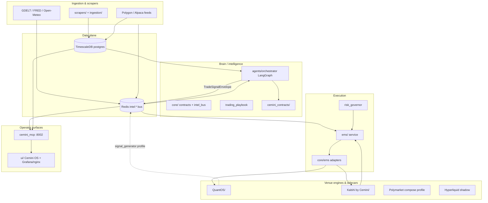

## Relations

- @projects/cemini-financial-suite/Cemini Financial Suite.md — project hub
- @projects/cemini-financial-suite/Architecture/Architecture - QuantOS.md
- @projects/cemini-financial-suite/Architecture/Architecture - Kalshi by Cemini.md
- @projects/cemini-financial-suite/Architecture/Architecture - core.md
- @projects/cemini-financial-suite/Architecture/Architecture - agents.md
- @projects/cemini-financial-suite/Architecture/Architecture - ems.md
- @projects/cemini-financial-suite/Architecture/Architecture - cemini_mcp.md
- @projects/cemini-financial-suite/Architecture/Architecture - Key decisions.md
- @projects/osint-workspace/Architecture/Architecture - Overview.md — parallel OSINT laptop pass @ 992f96a
- @concepts/cemini-repository-topology.md
- @entities/infrastructure/cemini-stack.md
- @concepts/librarian-server-architecture.md

## For future Claude

Prod `/opt/cemini` architecture map from server-Claude `/obsidian-architect` @ e3674e4 (2026-06-01). Mermaid stack diagram, module census, integration surfaces. Prefer this over laptop clone scan for deployed truth.

# Cemini Financial Suite — Architecture Overview

Private-use algorithmic trading monorepo on a single Hetzner VPS (`/opt/cemini`). **Phase:** paper trading / data accumulation; Kalshi prediction markets active per root README. Stack is orchestrated via `docker-compose.yml` (includes `docker/compose.{infra,ingestion,intelligence,execution,ui,observability,polymarket,hyperliquid,forex,crypto,arb}.yml`).

## Stack diagram

## Personas (from README + compose; rationale marked where inferred)

| Persona | Primary touchpoints | Role |
|---------|---------------------|------|
| **Platform operator** | `docker compose`, `deploy/systemd/`, Grafana/nginx | Keeps VPS stack healthy; does not flip trading gates without brief GO |
| **Brain cycle** | `agents/orchestrator.py`, `brain` container | LangGraph cycle: regime gate → signals → `TradeSignalEnvelope` on Redis |
| **EMS executor** | `ems/main.py`, `core/ems/router.py` | Subscribes to signals; routes orders through broker adapters (paper default) |
| **Kalshi autopilot** | `Kalshi by Cemini/`, `kalshi_autopilot` service | 30s scan-and-execute loop for prediction markets |
| **Quant researcher** | `research/`, `strategies/`, `QuantOS/` | Backtests and signal logic; QuantOS `signal_generator` profile disabled (redundant with `brain`) |
| **MCP / agent client** | `cemini_mcp/server.py` | Read-only tools over `intel:*` + Postgres risk readers |
| **Wiki / librarian** | kb-server on librarian host (not in this tree) | OSINT federation; conductor overlay optional via `ConductorClient` |

(confidence: speculation) **Cemini OS** persona maps to Streamlit `ui/` served as `cemini_os` on port 8501 behind nginx.

## Deterministic module census (@e3674e4)

<!-- @generated:start -->
| Module | Path | source_files | role_hint |
|--------|------|--------------|-----------|
| services | `services/` | 141 | core |
| tools | `tools/` | 129 | core |
| core | `core/` | 107 | core |
| db | `db/` | 85 | core |
| QuantOS | `QuantOS/` | 80 | core |
| cemini_contracts | `cemini_contracts/` | 78 | core |
| Kalshi by Cemini | `Kalshi by Cemini/` | 71 | core |
| research | `research/` | 37 | core |
| cemini_mcp | `cemini_mcp/` | 28 | core |
| ingestion | `ingestion/` | 13 | core |
| scrapers | `scrapers/` | 11 | core |
| agents | `agents/` | 10 | core |
| scripts | `scripts/` | (support) | support — ops/cron, not expanded here |

**Not present on prod tree:** `Cemini-Suite/` (laptop reference clone listed it; prod scan has no such directory).

**Languages (repo-wide):** Python 55.9%, Markdown 35.8%, Shell 4.8%, SQL 3.2%.
<!-- @generated:end -->

## Support modules (one line each)

| Path | Role |
|------|------|
| `scrapers/` | Host-side harvesters (GDELT, FRED, Open-Meteo, macro) feeding DB/Redis |
| `ingestion/` | Docker-oriented ingestors (Polygon, Alpaca, CCXT, calendars) |
| `scripts/` | Cron, audits, probes, one-off ops (largest surface; support) |
| `services/` | Long-running sidecars: `llm_analyst`, polymarket MCP adapters, harvesters |
| `strategies/` | Playbook-adjacent strategy implementations |
| `conductor/` | Reviewer/escalation prompts (librarian-side conductor referenced from agents) |
| `orchestration/` | **Not a top-level directory on prod** — orchestration lives in `agents/` + `docker/compose.intelligence.yml` |
| `ui/` | Streamlit Cemini OS + replay helpers |
| `deploy/systemd/` | Host timers for weather, PM, WC sleeves outside compose |

## Integration surfaces

| Surface | Location | Notes |
|---------|----------|-------|
| Typed contracts | `cemini_contracts/` | Pydantic envelopes (`TradeSignalEnvelope`, `IntelPayload`, PM/Kalshi domains) |
| Compose entry | `docker-compose.yml` | Includes 11 sub-compose files; networks `edge_net`, `app_net`, `data_net` |
| Redis | `core/intel_bus.py` | `intel:*` namespace; password from `.env` |
| TimescaleDB | `docker/compose.infra.yml` → `postgres` | DB `qdb`, user `admin` |
| MCP | `cemini_mcp/` | Port 8002, read-only FastMCP |
| kb-server | External (`10.0.0.2:3838` per runbooks) | Wiki enforcement gates in `core/wiki_enforcement.py` |
| Archives | `archives/`, `logs/` | JSONL audit / playbook / intent chains |

## Cross-wiki references (laptop OSINT federation)

- @concepts/librarian-server-architecture.md — kb-server + conductor (librarian host, not built from this tree)
- @projects/osint-workspace/Architecture/Architecture - Overview.md — laptop pass @ 992f96a

## @user notes

<!-- Edit below generated blocks; do not edit between @generated markers -->

_Add operator-specific prod deltas here after laptop ingest._
