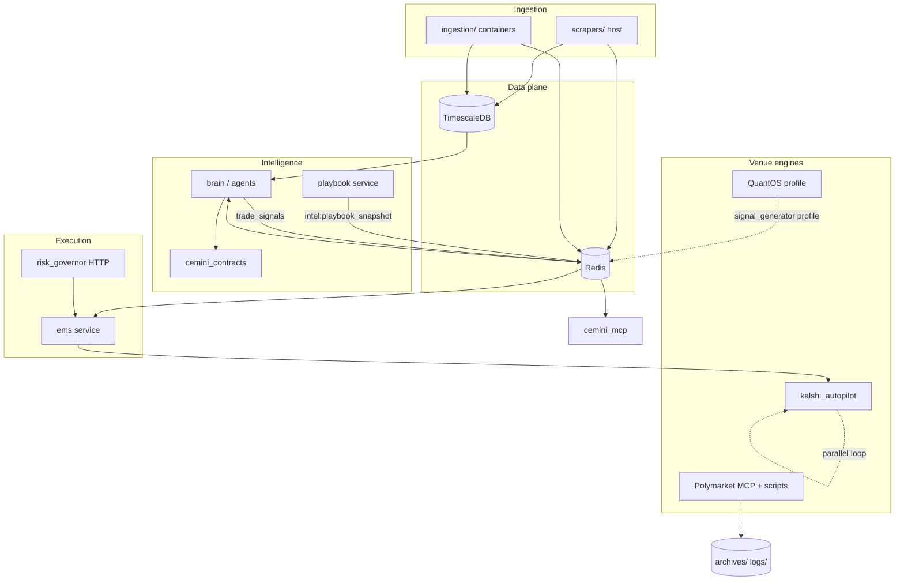
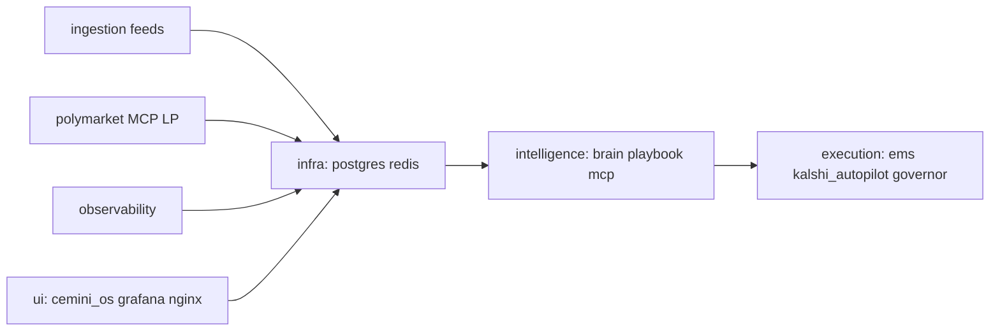
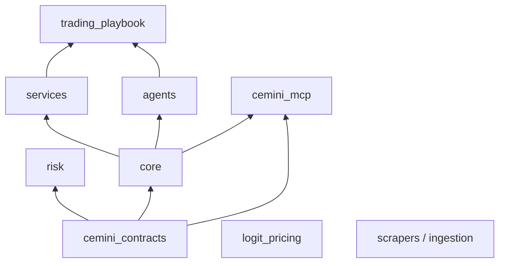

## Relations

- @projects/cemini-financial-suite/Cemini Financial Suite.md
- @projects/cemini-financial-suite/Architecture/Architecture - Index.md
- @projects/cemini-financial-suite/Architecture/OPEN-GAPS.md
- @projects/cemini-financial-suite/Architecture/Architecture - Docker services.md
- @projects/cemini-financial-suite/Architecture/Architecture - Kalshi by Cemini.md
- @projects/cemini-financial-suite/Architecture/Architecture - Key decisions.md
- @projects/cemini-financial-suite/Architecture/Architecture - Overview.md
- @projects/cemini-financial-suite/Architecture/Architecture - Polymarket.md
- @projects/cemini-financial-suite/Architecture/Architecture - QuantOS.md
- @projects/cemini-financial-suite/Architecture/Architecture - agents.md
- @projects/cemini-financial-suite/Architecture/Architecture - cemini_contracts.md
- @projects/cemini-financial-suite/Architecture/Architecture - cemini_mcp.md
- @projects/cemini-financial-suite/Architecture/Architecture - core.md
- @projects/cemini-financial-suite/Architecture/Architecture - data plane.md
- @projects/cemini-financial-suite/Architecture/Architecture - db ERD.md
- @projects/cemini-financial-suite/Architecture/Architecture - db.md
- @projects/cemini-financial-suite/Architecture/Architecture - debate and conductor.md
- @projects/cemini-financial-suite/Architecture/Architecture - deploy-systemd.md
- @projects/cemini-financial-suite/Architecture/Architecture - ems.md
- @projects/cemini-financial-suite/Architecture/Architecture - logit_pricing.md
- @projects/cemini-financial-suite/Architecture/Architecture - services.md
- @projects/cemini-financial-suite/Architecture/Architecture - shared and intelligence.md
- @projects/cemini-financial-suite/Architecture/Architecture - strategies.md
- @projects/cemini-financial-suite/Architecture/Architecture - tools.md

## For future Claude

Prod stack @ e8fd49f wave 4.

# Cemini Financial Suite — Architecture Overview

Private-use algorithmic trading monorepo on a single Hetzner VPS (`/opt/cemini`). **Phase:** paper trading / data accumulation; Kalshi prediction markets active per root README. Stack orchestrated via `docker-compose.yml` (11 included compose files).

**Index:** @projects/cemini-financial-suite/Architecture/Architecture - Index.md · **Open gaps:** @projects/cemini-financial-suite/Architecture/OPEN-GAPS.md

## Logical data flow

**Key Redis paths (evidence in code):**

| Key / channel | Producer | Consumer |
|---------------|----------|----------|
| `intel:playbook_snapshot` | `trading_playbook` / `playbook` | `agents` regime gate, MCP |
| `trade_signals` | `agents/orchestrator.py` (`ENABLE_BRAIN_PUBLISH`) | `ems/main.py` |
| `intel:*` | Harvesters, playbook, Kalshi rover | Brain, MCP, dashboards |

Kalshi **autopilot** runs as its own container; EMS also holds Kalshi REST credentials for brain-routed signals — not a single serial pipeline.

## Docker runtime topology (summary)

See @projects/cemini-financial-suite/Architecture/Architecture - Docker services.md for full tables. Grouped by compose file:

## Import layers (CI-enforced)

From `scripts/check_imports.py` — simplified:

Violations fail CI (`import-boundary-check` in `deploy.yml`).

## Personas

| Persona | Touchpoints | Role |
|---------|-------------|------|
| **Platform operator** | `docker compose`, @projects/cemini-financial-suite/Architecture/Architecture - deploy-systemd.md, Grafana/nginx | Stack health; no gate flips without brief GO |
| **Brain cycle** | `agents/orchestrator.py`, `brain` | LangGraph → `TradeSignalEnvelope` on `trade_signals` |
| **Playbook** | `trading_playbook/runner.py`, `playbook` | Regime + risk observation → `intel:playbook_snapshot` |
| **EMS executor** | `ems/main.py`, `core/ems/router.py` | Subscribes `trade_signals`; governor pre-check |
| **Kalshi autopilot** | @projects/cemini-financial-suite/Architecture/Architecture - Kalshi by Cemini.md | Parallel prediction-market loop |
| **PM operator** | @projects/cemini-financial-suite/Architecture/Architecture - Polymarket.md, `cemini-pm-*` timers | CLOB sleeves, host scripts |
| **MCP client** | @projects/cemini-financial-suite/Architecture/Architecture - cemini_mcp.md | Read-only intel tools (29 @ `e8fd49f`) |
| **Wiki / librarian** | kb-server `10.0.0.2:3838` (external) | `wiki_search`, `core/wiki_enforcement` |

## Module census (@e8fd49f)

<!-- @generated:start -->
| Module | Path | source_files | role_hint |
|--------|------|--------------|-----------|
| services | `services/` | 141 | core — @projects/cemini-financial-suite/Architecture/Architecture - services.md |
| tools | `tools/` | 129 | support — @projects/cemini-financial-suite/Architecture/Architecture - tools.md |
| core | `core/` | 107 | core — @projects/cemini-financial-suite/Architecture/Architecture - core.md |
| db | `db/` | 85 | core — @projects/cemini-financial-suite/Architecture/Architecture - db.md |
| QuantOS | `QuantOS/` | 80 | core — @projects/cemini-financial-suite/Architecture/Architecture - QuantOS.md |
| cemini_contracts | `cemini_contracts/` | 78 | core — @projects/cemini-financial-suite/Architecture/Architecture - cemini_contracts.md |
| Kalshi by Cemini | `Kalshi by Cemini/` | 71 | core — @projects/cemini-financial-suite/Architecture/Architecture - Kalshi by Cemini.md |
| research | `research/` | 37 | core |
| cemini_mcp | `cemini_mcp/` | 28 | core — @projects/cemini-financial-suite/Architecture/Architecture - cemini_mcp.md |
| trading_playbook | `trading_playbook/` | 10 | core — @projects/cemini-financial-suite/Architecture/Architecture - trading_playbook.md |
| agents | `agents/` | 10 | core — @projects/cemini-financial-suite/Architecture/Architecture - agents.md |
| ingestion | `ingestion/` | 13 | core |
| scrapers | `scrapers/` | 11 | core |

**Absent on prod:** `Cemini-Suite/` (laptop-only in reference clone).

**Languages:** Python 55.9%, Markdown 35.8%, Shell 4.8%, SQL 3.2%.
<!-- @generated:end -->

## Integration surfaces

| Surface | Location |
|---------|----------|
| Contracts | `cemini_contracts/` |
| Compose | `docker-compose.yml` |
| Redis intel bus | `core/intel_bus.py` |
| TimescaleDB | `docker/compose.infra.yml` → `postgres` |
| MCP | `cemini_mcp/` :8002 |
| kb-server | External; wiki enforcement in `core/wiki_enforcement.py` |
| Host timers | `deploy/systemd/` — @projects/cemini-financial-suite/Architecture/Architecture - deploy-systemd.md |
| Secrets (do not edit in arch pass) | `.env`, `conviction.yaml`, token mounts |

## Cross-wiki (laptop federation)

- `projects/osint-workspace/Architecture/` @ `992f96a` (parallel pass)
- `concepts/librarian-server-architecture.md`, `concepts/cemini-repository-topology.md`

## @user notes
