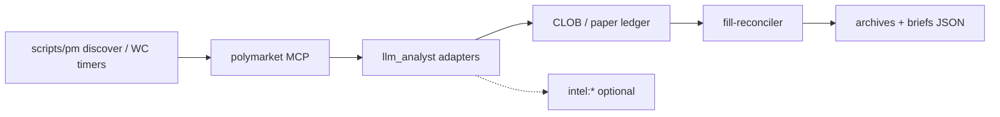

## Relations

- @projects/cemini-financial-suite/Cemini Financial Suite.md — project hub
- @projects/cemini-financial-suite/Architecture/Architecture - Overview.md
- @projects/cemini-financial-suite/Architecture/Architecture - Index.md — MOC

## For future Claude

Prod module `Polymarket` @ de5ad93; gap-close handoff.

# Polymarket — Prediction-market sleeve (parallel path)

Polymarket execution is largely **outside** the classic `brain → trade_signals → ems` equity path. It uses dedicated compose services, `services/llm_analyst/` adapters, host `scripts/pm_*`, and `cemini_contracts/polymarket*.py`.

## Runtime surfaces

| Surface | Location |
|---------|----------|
| Compose | `docker/compose.polymarket.yml` (+ `compose.polymarket.phase2.yml`, fill-stage overrides) |
| MCP | `polymarket-predictions-mcp`, `polymarket-trading-mcp` |
| LP / fills | `lp-rewards-bot`, `lp-flox-ws`, `fill-reconciler`, `inventory-flattener` |
| Analyst code | `services/llm_analyst/polymarket_*` |
| Contracts | `cemini_contracts/polymarket.py`, `pm_btc_updown.py`, `pm_kl_stat_arb.py`, … |
| Host ops | `deploy/systemd/cemini-pm-*.timer` (see @projects/cemini-financial-suite/Architecture/Architecture - deploy-systemd.md) |
| Logs / audit | `logs/pm_*.jsonl`, `archives/audit/intents/` |

## Data flow (simplified)

## Cross-venue

- **PM ↔ Kalshi stat arb:** `pm_kl_stat_arb`, `scripts/pm_kl_*`, config `config/pm_kl_curated_pairs.json`
- **Weather:** EMOS promote timers, `open_meteo` harvesters — see systemd PM weather timers

## Not documented here (see OPEN-GAPS)

- Live vs paper gate flags per sleeve (`conviction.yaml` — user-gated, not in this pack)
- Full CLOB order-state machine — see `docs/runbooks/` and K-series briefs

## Related

- @projects/cemini-financial-suite/Architecture/Architecture - services.md
- @projects/cemini-financial-suite/Architecture/Architecture - cemini_contracts.md
- @projects/cemini-financial-suite/Architecture/Architecture - Kalshi by Cemini.md — Kalshi leg of stat arb

## @user notes
