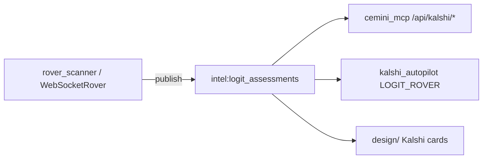

## Relations

- @projects/cemini-financial-suite/Cemini Financial Suite.md
- @projects/cemini-financial-suite/Architecture/Architecture - Overview.md
- @projects/cemini-financial-suite/Architecture/Architecture - Index.md

## For future Claude

Prod `logit_pricing` @ 8faf94e.

# logit_pricing — Kalshi fair-value / logit assessments

Foundation-tier package (`check_imports.py`: imports only `cemini_contracts`). Powers **logit fair values** for Kalshi desk and autopilot.

## Code map

| File | Role |
|------|------|
| `pricing_engine.py` | Core pricing |
| `models.py`, `jump_diffusion.py` | Model layer |
| `transforms.py`, `indicators.py`, `precision.py` | Math helpers |

## Runtime path

| Component | Evidence |
|-----------|----------|
| Publisher | `Kalshi by Cemini/modules/market_rover/ws_rover.py` → `intel:logit_assessments` TTL 600s |
| Consumer | `autopilot.py` mines logit assessments |
| MCP / UI | `cemini_mcp/server.py`, `design/README.md` — PARTIAL without key |
| Compose | `rover_scanner` in `docker/compose.execution.yml` |

## Related

- @projects/cemini-financial-suite/Architecture/Architecture - Kalshi by Cemini.md
- @projects/cemini-financial-suite/Architecture/Architecture - ui.md
- @projects/cemini-financial-suite/Architecture/Architecture - cemini_mcp.md

## @user notes
