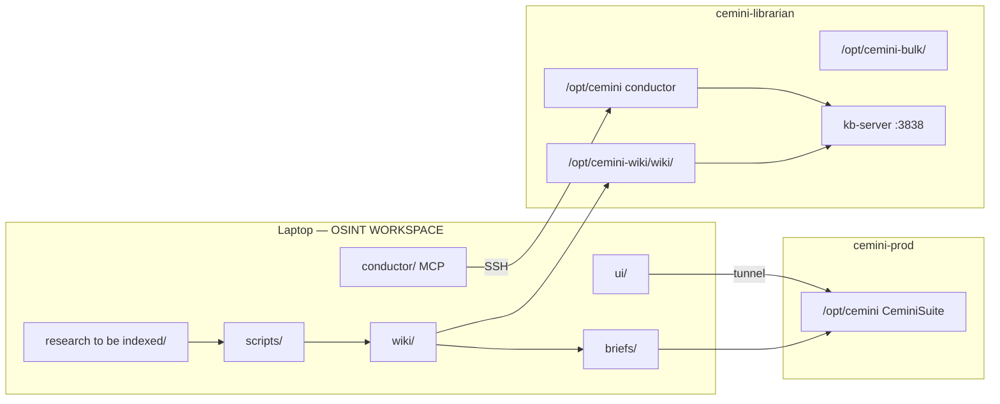

## Relations

- @projects/osint-workspace/OSINT Workspace.md — project hub
- @concepts/librarian-server-architecture.md — kb-server + bulk storage on librarian
- @concepts/cemini-repository-topology.md — deploy monorepo vs this research repo
- @projects/cemini-financial-suite/Architecture/OPEN-GAPS.md — prod architecture deferred areas

## For future Claude

Top-level map of the **OSINT WORKSPACE** git repo as of commit `b960aae` (2026-06-01). The repo is ~88% Markdown (wiki + briefs); executable code is mostly `scripts/` (lint, ingest gates, backtests, sync) plus `conductor/` (MCP proxy to prod conductor on librarian). Re-run `/obsidian-architect` to refresh only `@generated` blocks.

<!-- @generated:start -->

## What this repository is

**Cemini OSINT Research Workspace** — local knowledge hub: immutable raw sources on `cemini-librarian`, LLM-curated `wiki/`, schema in root `CLAUDE.md`, and Python automation. [Source: `README.md` at repo root, retrieved 2026-06-01]

This is **not** `/opt/cemini` (CeminiSuite). Prod code changes happen in `Cemini-Financial-Suite`; this repo stages research and ships **briefs** only across the deployment boundary.

## Stack (deterministic scan)

| Signal | Value |
| --- | --- |
| **Kind** | Node-adjacent monorepo (no root `package.json` app; tiny `ui/` + `conductor/requirements.txt`) |
| **Languages** | Markdown 87.6%, Python 9.2%, Shell 2.2%, TypeScript 0.7% |
| **CI** | `.github/workflows/lint.yml` (weekly + push `wiki_lint.py`), `links.yml` |
| **Docker / Makefile** | None at repo root |
| **Declared dependencies** | None in scan manifest (Python deps per-script / `conductor/requirements.txt`) |
| **Git** | `b960aae`, clean tree at scan time |

## Modules and flow

| Module | Path | Role | Doc |
| --- | --- | --- | --- |
| **wiki** | `wiki/` | Canonical curated library (`sources/`, `entities/`, `concepts/`, `sweeps/`, `meta/`) | [[projects/osint-workspace/Architecture/Architecture - wiki\|Architecture - wiki]] |
| **conductor** | `conductor/` | Laptop MCP server; routes `conductor_query` to librarian prod conductor | [[projects/osint-workspace/Architecture/Architecture - conductor\|Architecture - conductor]] |
| **briefs** | `briefs/` | Gitignored staging for claude.ai / CeminiSuite handoff | [[projects/osint-workspace/Architecture/Architecture - briefs\|Architecture - briefs]] |
| **ui** | `ui/` | Local static chat UI + `serve.py` proxy to egress gateway | [[projects/osint-workspace/Architecture/Architecture - ui\|Architecture - ui]] |
| **scripts** | `scripts/` | Ingest/lint/sync/backtest/cadence automation (123+ Python files) | One-liner below |

**scripts/** (support): `wiki_lint.py`, `preingest_check.py`, `ingest_session_gate.py`, `sync_wiki_to_librarian.sh`, daily digest + quarterly backtest runners, cross-wiki routing, Obsidian setup. No single entry binary — invoked by operator, LaunchAgents, or CI.

## Personas

| Persona | Goal | Typical surfaces |
| --- | --- | --- |
| **Curator / researcher** | Ingest sources, grow wiki, stage briefs | `wiki/`, `research to be indexed/`, Obsidian graph, `ROADMAP.md` |
| **Agent (Cursor / Claude Code)** | Query wiki, lazy-tool → kb-server, respect ingest gates | `CLAUDE.md`, `wiki/_CLAUDE.md`, MCP (`lazy-tool`, `stash`) |
| **Prod operator** | Consume briefs on `cemini-prod`; never edit wiki from prod | SSH server-Claude, `/opt/cemini/briefs/` |
| **Automation** | Cadence checks, lint, inbox notify | `scripts/check_*_due.sh`, GitHub Actions | 

(confidence: speculation for persona table — inferred from `CLAUDE.md` + `README.md`, not a formal product spec)

## Integration boundaries

1. **Raw layer** — `cemini-librarian:/opt/cemini-bulk/` (PDFs, market data); laptop drop zone is transient.
2. **Serving layer** — hourly `scripts/sync_wiki_to_librarian.sh` → kb-server FTS/RAG.
3. **Execution layer** — briefs only into prod; read-only `ssh` verification elsewhere on prod.

See @concepts/laptop-prod-research-split.md for the operational split.

<!-- @generated:end -->

## Operator notes

- Vault-specific rules: `wiki/_CLAUDE.md` (no stock `/obsidian-init`; append ops to `wiki/log.md` not `Logs/`).
- Federation map: @concepts/cemini-repository-topology.md.
- Prod deploy: @projects/cemini-financial-suite/Architecture/Architecture - Overview.md @ `e8fd49f`; gaps: @projects/cemini-financial-suite/Architecture/OPEN-GAPS.md.
