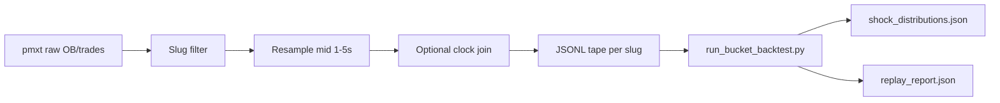

## Relations

- @projects/world-cup-bot/Architecture/Architecture - match_shock_v1.md — module spec this backtest feeds
- @entities/tools/pmxt.md — 1TB open orderbook archive (primary data path)
- @entities/tools/polymarket-clob-api.md — live WS capture schema aligns with CLOB trades

## For future Claude

Executable scaffold: `world-cup-bot/scripts/shock_backtest/run_bucket_backtest.py`. This page is the **data engineering design** for turning pmxt history into `shock_distributions.json` for live bucket lookup.

## Objective

Answer before WC kickoff (2026-06-11):

1. Which **bucket keys** have ≥5 shock samples with stable recovery?
2. Does **`moderate_fav`** filtering beat all-bucket baseline (RoH claim)?
3. What **win rate / PnL** does the 4¢ recovery target produce on historical tapes?

## Data sources (priority order)

| Priority | Source | Pros | Cons |
|----------|--------|------|------|
| **1** | pmxt 1TB orderbook archive | Free, Cemini already evaluating (@entities/tools/pmxt.md) | 1TB+ scale; needs librarian staging |
| **2** | Dome API (Polymarket-acquired 2026-02-19) | Unified historical trades + OB | Third-party; rate limits |
| **3** | Live CLOB WS capture | WC-native slugs + clocks | No history until tournament starts |
| **4** | Gamma + public trade API | Quick laptop prototype | Incomplete OB depth for classifier dim 3 |

**Recommendation:** pmxt subset on **cemini-librarian** — not laptop full mirror, not prod.

## Staging layout (librarian)

```
/opt/cemini-bulk/market-dataset/polymarket-orderbook/
  pmxt-mirror/              # selective sync (football slugs only)
  exports/
    shock-backtest/
      tapes/                # one JSONL per market slug
      shock_distributions.json
      replay_report.json
```

Sync policy: see `@entities/tools/pmxt.md` — subset by slug prefix + date range (2024–2025 football season + WC friendlies).

## ETL pipeline



### Step 0 — Sync (automated)

```bash
bash scripts/shock_backtest/sync_pmxt_football_to_librarian.sh --hours 24
# OSINT wrapper: bash scripts/sync_pmxt_football_to_librarian.sh --hours 24
```

Downloads hourly files from `https://r2v2.pmxt.dev/polymarket_orderbook_{YYYY-MM-DDTHH}.parquet` (v2 object store; listing UI at `archive.pmxt.dev` is HTML-only). **Upload pause [NEEDS VERIFICATION 2026-06-02]:** latest objects observed through `2026-05-25T08` UTC only.

### Step 1 — Market filter (manual override)

Include slugs matching `config/shock_match.yaml` `markets.slug_patterns`.

Exclude `markets.blocked_slug_patterns` (advance, group-winner, outright winner).

Gamma metadata join for sport tag = football/soccer when slug ambiguous.

### Step 2 — Trade tape export

Target schema (one line per observation):

```json
{
  "ts_ms": 1710000000000,
  "price": 0.30,
  "slug": "epl-man-united-win-2025-04-01",
  "elapsed_ms": 2100000,
  "goal_diff": 0,
  "bids": [{"price": 0.29, "size": 120}]
}
```

| Field | Derivation |
|-------|------------|
| `ts_ms` | pmxt trade timestamp or mid snapshot time |
| `price` | last trade or mid of YES token |
| `slug` | pmxt market slug |
| `elapsed_ms` | **Best:** Opta/stadium feed join. **MVP:** 0 (early bucket bias — document in report) |
| `goal_diff` | **Best:** live score API. **MVP:** infer from large sustained mid jumps or manual WC replay CSV |
| `bids` | top-N bid levels from pmxt OB snapshot nearest `ts_ms` |

### Step 3 — Shock scan + bucket accumulation

Uses repo functions:

- `detect_shock()` — 2m window, 15%/8¢ thresholds from YAML
- `bucket_key()` — five dimensions
- `build_distributions()` — append depth_cents per bucket

Output: `shock_distributions.json` → `{ "deep|moderate_fav|balanced|mid|level": [8.1, 12.4, ...], ... }`

### Step 4 — Paper replay

`--replay` flag:

- For each shock, `plan_ladder()` with **frozen** distribution file (walk-forward optional v2)
- `simulate_paper_fill()` at post-shock low
- Exit at `min(recovery_target, pre_price)`
- Aggregate win rate vs `backtest.min_recovery_rate` (default 55%)

### Step 5 — Bucket tuning matrix

Run grid (laptop or librarian):

| Run | `allowed_favoritism` | `allowed_league_tiers` | Notes |
|-----|---------------------|------------------------|-------|
| A | *(all)* | deep | Baseline |
| B | moderate_fav | deep | RoH claim |
| C | moderate_fav, slight_fav | deep | Expanded |
| D | moderate_fav | deep, unknown | WC slugs often `unknown` league |

Promote config row with best **win_rate × sqrt(n_trades)** (penalize thin buckets).

## Walk-forward extension (v2)

Hold out last 20% of matches per slug chronologically:

1. Train distributions on first 80%
2. Replay on last 20%
3. Reject buckets where out-of-sample win rate drops >10pp

Not in scaffold script yet — manual split via `ts_ms` cut.

## Live WC capture (parallel track)

During tournament:

```bash
# Future: world-cup-bot match-shock-record --slug-filter world-cup
# Writes data/local/shock_tapes/YYYY-MM-DD.jsonl
```

Nightly cron merges new shocks into distributions (decay weight optional).

## Commands

```bash
# Fixture smoke (repo root)
python scripts/shock_backtest/run_bucket_backtest.py \
  tests/fixtures/shock_replay/sample_trades.jsonl \
  --out-distributions data/local/shock_distributions.json \
  --replay

# Production (librarian, after ETL)
python scripts/shock_backtest/run_bucket_backtest.py \
  /opt/cemini-bulk/market-dataset/polymarket-orderbook/exports/shock-backtest/tapes/combined.jsonl \
  --out-distributions /opt/cemini-bulk/market-dataset/polymarket-orderbook/exports/shock-backtest/shock_distributions.json \
  --replay
```

## Deliverables checklist

- [ ] pmxt football subset staged on librarian
- [ ] ETL script `export_pmxt_shock_tapes.py` (not yet written — extract from pmxt normalized schema)
- [ ] Grid runs A–D with `replay_report.json` per run
- [ ] Update `config/shock_match.yaml` `backtest.allowed_*` from best run
- [ ] Brief to prod if live module GO (`briefs/YYYY-MM-DD_wc-match-shock-v1-cemini.md`)

## Known gaps / MVP caveats

- **No match clock in MVP tapes** → `elapsed_ms=0` biases toward `early` bucket; WC live capture must fix before live money.
- **Score inference** without feed → skip `goal_state` precision or use manual CSV for WC replays only.
- **RoH repo DM-gated** — cannot diff implementation until public fork.
- **Courtsiding** — backtest on PM trade tape ignores faster external feeds; live EV may be lower than replay.

## Cost / storage

- pmxt full mirror: 1TB+ — **do not** laptop download
- Football subset estimate: 5–20GB (2024–25 major leagues) — librarian snapshot OK
- Compute: single-pass backtest ~minutes on JSONL; grid 4 runs negligible
