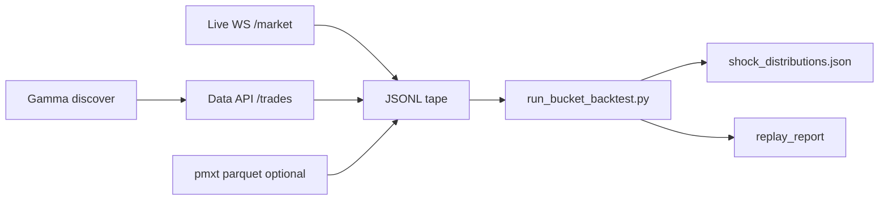

## Relations

- @projects/world-cup-bot/Architecture/Architecture - match_shock_v1.md — module spec this backtest feeds
- @entities/tools/polymarket-clob-api.md — live WS capture schema
- @entities/tools/pmxt.md — optional deep orderbook archive

## For future Claude

Executable scaffold: `world-cup-bot/scripts/shock_backtest/run_bucket_backtest.py`. This page documents **how to build shock JSONL tapes** for bucket distributions and paper replay.

## Objective

Answer before WC kickoff (2026-06-11):

1. Which **bucket keys** have ≥5 shock samples with stable recovery?
2. Does **`moderate_fav`** filtering beat all-bucket baseline (RoH claim)?
3. What **win rate / PnL** does the 4¢ recovery target produce on historical tapes?

## Data sources (priority order, 2026-06-03)

| Priority | Source | Status | Notes |
|----------|--------|--------|-------|
| **1** | **Gamma + Data API** | **Shipped** | `match-shock-discover` → `match-shock-export`; `takerOnly=false` |
| **2** | **Live CLOB `/ws/market`** | **Shipped** | `match-shock-record`; primary for WC 2026 slugs |
| **3** | pmxt parquet archive | Optional / librarian | Deprioritized when mirror hours lack football slugs |
| ~~4~~ | ~~Dome API~~ | **EOL 2026-04-28** | Polymarket acquisition — do not integrate |

**Recommendation:** Path 1 for pre-tournament tuning on EPL/UCL/WC 2022 replays; Path 2 from Jun 11 for WC-native slugs.

## Operator workflow (Path 1 + 2)

```bash
# Discovery
world-cup-bot match-shock-discover --out data/local/match_markets.json

# Historical export (Data API)
world-cup-bot match-shock-export \
  --discovery data/local/match_markets.json \
  --out-dir data/local/shock_tapes \
  --max-trades 5000

# Bucket backtest
python scripts/shock_backtest/run_bucket_backtest.py \
  data/local/shock_tapes/combined.jsonl \
  --out-distributions data/local/shock_distributions.json \
  --replay

# Live capture (tournament)
WC_SHOCK_ENABLED=1 world-cup-bot match-shock-record \
  --discovery data/local/match_markets.json
```

Pilot (2026-06): Gamma returns ~206 match slugs; **WC 2026 match markets not listed yet**. Data API retains trades for some settled markets (e.g. UCL draw markets); many WC 2022 slugs return empty — filter by volume.

## Staging layout (librarian — pmxt optional)

```
/opt/cemini-bulk/market-dataset/polymarket-orderbook/
  pmxt-mirror/staging/parquet/     # optional hourly parquet
  exports/shock-backtest/
    tapes/combined.jsonl
    shock_distributions.json
```

Laptop default: `data/local/shock_tapes/` (`WC_MATCH_SHOCK_TAPE_DIR`).

## ETL pipeline



## JSONL schema

```json
{
  "ts_ms": 1710000000000,
  "price": 0.30,
  "slug": "epl-man-united-win-2025-04-01",
  "elapsed_ms": 2100000,
  "goal_diff": 0,
  "bids": [{"price": 0.29, "size": 120}]
}
```

| Field | Data API export | Live WS | pmxt |
|-------|-----------------|---------|------|
| `ts_ms`, `price`, `slug` | yes | yes | yes |
| `bids[]` | no | yes | yes |
| `elapsed_ms`, `goal_diff` | 0 (MVP) | 0 until score feed | optional join |

## pmxt sync (optional)

```bash
bash scripts/shock_backtest/sync_pmxt_football_to_librarian.sh --hours 24
# OSINT: bash scripts/sync_pmxt_football_to_librarian.sh
```

Parquet URL: `https://r2v2.pmxt.dev/polymarket_orderbook_{YYYY-MM-DDTHH}.parquet`.

**Lesson:** May 2026 mirror hours may contain **zero football slugs** — validate slug density before full-hour ETL on 3.7GB RAM librarian.

## Bucket tuning matrix

| Run | `allowed_favoritism` | `allowed_league_tiers` | Notes |
|-----|---------------------|------------------------|-------|
| A | *(all)* | deep | Baseline |
| B | moderate_fav | deep | RoH claim |
| C | moderate_fav, slight_fav | deep | Expanded |
| D | moderate_fav | deep, unknown | WC slugs often `unknown` league |

## Deliverables checklist

- [x] Gamma discovery CLI
- [x] Data API export CLI (`data-api.polymarket.com` allowlisted in `http_client.py`)
- [x] Live WS record CLI
- [x] `export_pmxt_shock_tapes.py` + parquet converter (optional path)
- [ ] Grid runs A–D with documented `replay_report`
- [ ] Update `config/shock_match.yaml` `backtest.allowed_*` from best run
- [x] Brief to prod (`briefs/2026-06-03_wc-match-shock-dual-path-cemini.md`)

## Known gaps / MVP caveats

- **No match clock in MVP tapes** → `elapsed_ms=0` biases toward `early` bucket; WC live capture + score feed required before live money.
- **Data API pagination** — effective offset ceiling ~1000; use slug-level export + `max-trades` cap.
- **RoH repo DM-gated** — cannot diff implementation until public fork.
- **Courtsiding** — backtest on PM trade tape ignores faster external feeds; live EV may be lower than replay.

## Cost / storage

- Data API export: laptop-friendly; rate-limit with default 50ms page sleep
- pmxt football subset: 5–20GB estimate on librarian — only after football-dense hours confirmed
- Live WS: append-only JSONL; negligible storage during WC
